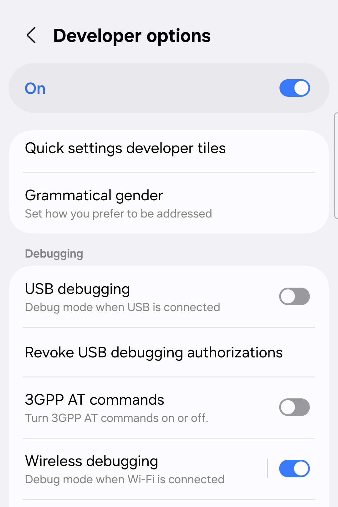
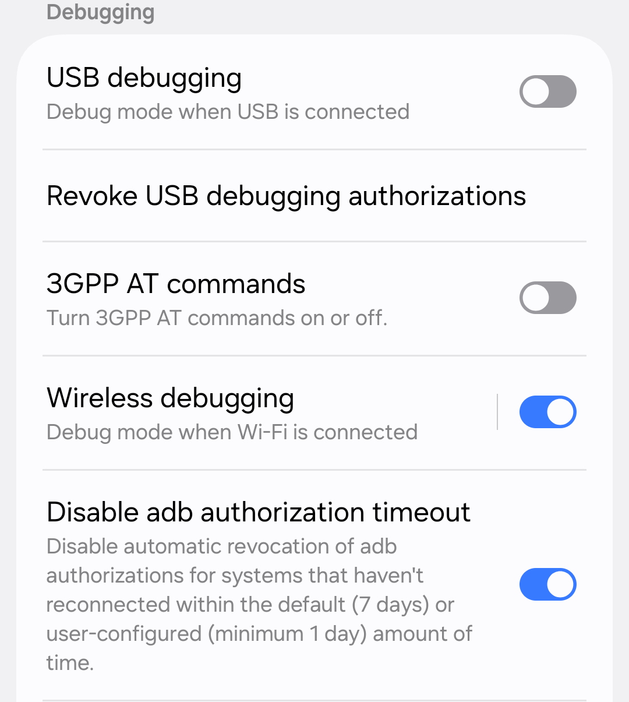
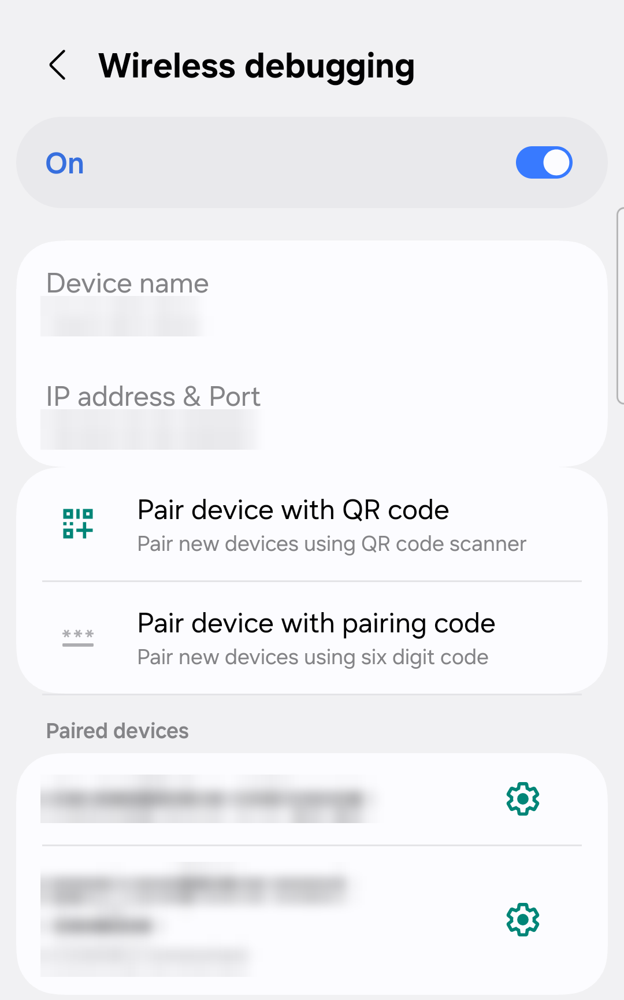

# 5dive phone

<p align="center">
  
</p>

**A spare Android phone for your AI agents.** They read the screen, tap and type in any Android
app, and ask you before they pay.

Works with any agent 5dive runs: Claude Code, Codex and more. Free and open source.

[5dive.ai/phone](https://5dive.ai/phone) · [Walkthrough](https://blog.5dive.ai/blog/ai-agent-control-android-phone/) · [5dive](https://github.com/5dive-ai/5dive)

```
  Your server (agent)  ──── Tailscale ────  Spare Android phone
                                            on a charger
  "post our video on TikTok with this week's trending sound"
     1. reads the screen
     2. taps and types        picks the sound, writes the caption
     3. about to pay?         it asks you first
```

## What it's for

- **Testing the app your coding agent just built.** Onboarding, permissions, the button the
  keyboard hides. Each bug comes back with a screenshot and the steps.
- **Watching rivals' apps.** Every Monday: the paywall, the prices, the trial, and the discounts
  they only show inside the app.
- **Checking ad links.** It taps every link on a real phone before the campaign goes live.
- **Posts your scheduler can't finish.** A trending sound from TikTok's own library, a poll on
  an Instagram Story.

## Install

You need 5dive first. On Ubuntu or Debian it's one command:

```sh
curl -fsSL https://install.5dive.ai | sudo bash
```

Then add the phone:

```sh
sudo 5dive plugin add 5dive-ai/5dive-phone
sudo 5dive phone setup   # installs adb, Android's own debugging tool
sudo 5dive init          # your first agent, after setup so it gets the phone
```

Already on 5dive? Tell your agent "add phone control".

## Connect the phone (once, about 5 minutes)

Use a spare phone, not your own: its screen lock gets switched off. Keep it on a charger, then
tell your agent "connect my phone". It walks you through these steps:

1. **Settings › About phone**, tap **Build number** seven times. (Samsung: it is under Software
   information.)
2. Install **Tailscale** on the phone and sign in with the same account as your server.
3. In **Developer options**, turn on **Stay awake** and **Disable adb authorization timeout**
   (Android 11+). Set **Screen lock** to None or Swipe.
4. Turn on **Wireless debugging** and tap **Pair device with pairing code**. Give your agent the
   6-digit code and the port shown under it. Keep that screen open until it says it's connected.
5. If the phone asks **"Allow debugging?"**, tick Always allow and tap Allow.

<p>
  
  
  
</p>

Tailscale is the only app you install. The agent uses adb, which ships inside Android, and a
dropped connection comes back by itself.

## You decide what it does alone

Paying always asks you first, as an Approve button in Telegram. Sending, posting and deleting go
ahead and are logged, unless you switch to careful:

```sh
sudo 5dive phone approvals policy set careful   # ask before sending, posting and deleting too
```

The same switch covers [5dive browser](https://github.com/5dive-ai/5dive-browser), which
handles websites. The phone is for apps.

## Limits

- **A locked phone can't be used.** Set the screen lock to None or Swipe.
- **After a restart**, switch Wireless debugging back on. The agent finds the phone by itself: no
  port, no new code.
- **Android only** for now.
- **Some apps refuse to run** with developer mode on, banking apps most of all. Some ban
  automated taps: check an app's terms before you hand it over.

## More

- What the agent runs: [`phone/README.md`](phone/README.md)
- Changes: [`CHANGES.md`](CHANGES.md) · Contributing: [`CONTRIBUTING.md`](CONTRIBUTING.md)
- Apache 2.0, see [`LICENSE`](LICENSE). Part of [5dive](https://5dive.ai).
